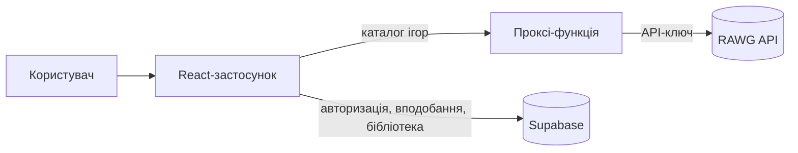
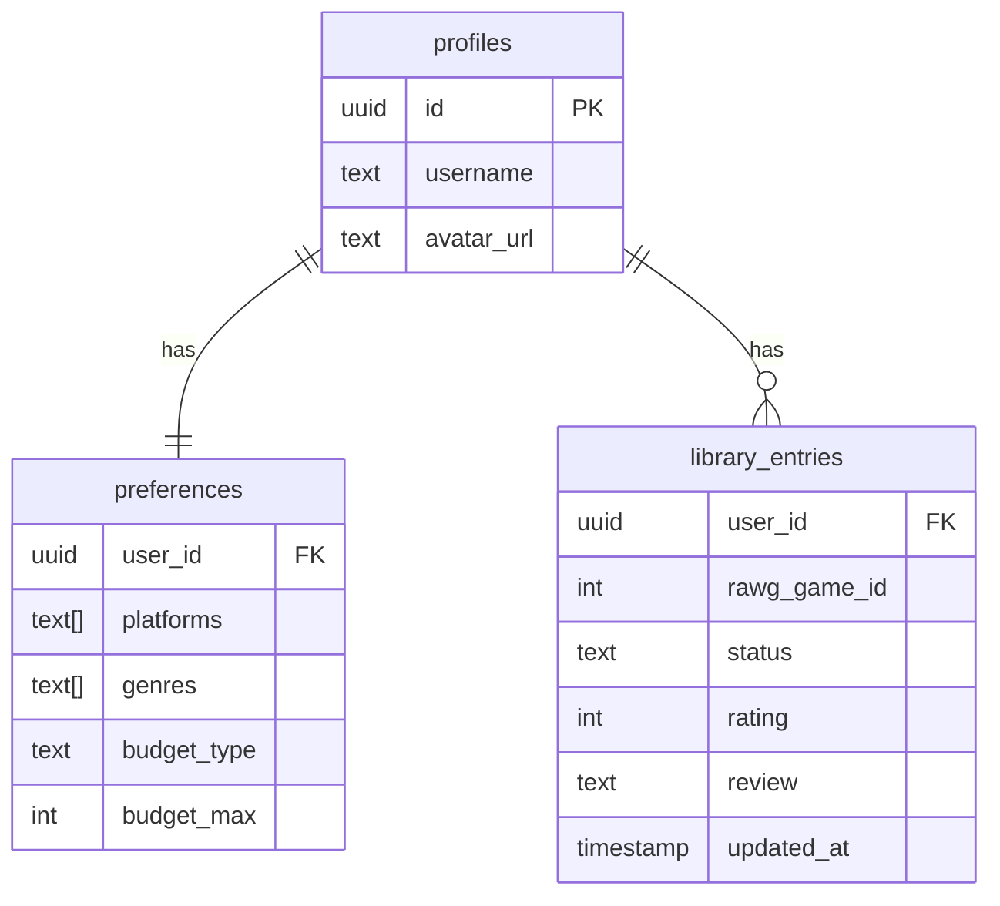

[README.md](https://github.com/user-attachments/files/33429299/README.md)

# 🎮 GameMatch

Мобільний вебзастосунок для підбору відеоігор під смак, платформи та бюджет користувача.
Користувач проходить короткий онбординг, після чого отримує колоду карток з іграми та свайпає їх: пропустити, зберегти або додати до списку «Хочу зіграти».

> Менше пошуку. Більше гри.

---

## 1. Стек технологій

| Шар | Технологія | Навіщо |
|---|---|---|
| Фронтенд | React + TypeScript (TSX) + Vite | Інтерфейс, mobile-first |
| Роутинг | React Router | Навігація між екранами |
| Запити до API | TanStack Query (React Query) | Кеш, loading/error-стани |
| Глобальний стан | Zustand | Дані онбордингу, поточний користувач |
| Свайпи | framer-motion | Анімація та жести карток |
| База даних і авторизація | Supabase (PostgreSQL + Auth) | Профілі, вподобання, бібліотека |
| Каталог ігор | RAWG API | Ігри, жанри, платформи, рейтинги |
| Проксі до RAWG | Supabase Edge Function / Vercel Function | Ключ API не потрапляє в браузер |
| Якість коду | ESLint + Prettier | Єдиний стиль у команді |

---

## 2. Загальна схема



Принцип розподілу даних:

- **RAWG** відповідає за каталог ігор: назви, обкладинки, жанри, рейтинги, платформи.
- **Supabase** відповідає за все, що належить користувачу: акаунт, вподобання, свайпи, списки.
- У базі зберігається лише `rawg_game_id`. Деталі гри щоразу підтягуються з RAWG і кешуються на клієнті.

---

## 3. Екрани та маршрути

| Маршрут | Екран | Нижня навігація |
|---|---|---|
| `/welcome` | Вітання («Знайти свою гру») | ні |
| `/onboarding/platforms` | Крок 1/3: платформи | ні |
| `/onboarding/genres` | Крок 2/3: жанри | ні |
| `/onboarding/budget` | Крок 3/3: бюджет | ні |
| `/deck` | «Для тебе»: колода свайпів | так |
| `/search` | Пошук | так |
| `/wishlist` | «Хочу зіграти» | так |
| `/game/:id` | Деталі гри | так |
| `/profile` | Профіль і статистика | так |
| `/settings` | Налаштування підбору, акаунти, сповіщення | так |

---

## 4. Структура проєкту

```
src/
├── api/
│   ├── rawg.ts              # запити до RAWG через проксі
│   └── supabase.ts          # клієнт Supabase
├── features/
│   ├── onboarding/          # три кроки онбордингу
│   ├── deck/                # GameCard, SwipeDeck, ActionButtons
│   ├── library/             # списки: хочу зіграти, збережені, пройдені
│   ├── search/
│   └── profile/
├── components/              # Button, Chip, SelectableCard, BottomNav
├── hooks/                   # useRecommendations, useLibrary
├── store/                   # onboardingStore, userStore (Zustand)
├── types/                   # Game, Preferences, LibraryEntry
├── pages/                   # WelcomePage, DeckPage, ProfilePage ...
├── utils/
├── App.tsx
└── main.tsx
```

### Правила для команди

1. Компоненти **не викликають API напряму**. Усі запити лежать у `src/api/`.
2. Дані з API отримуємо через хуки з `src/hooks/` (TanStack Query).
3. Форму даних (гра, вподобання, запис бібліотеки) описуємо в `src/types/`. Функції в `src/api/` повертають типізовані результати.
4. Тип `any` не використовуємо. Якщо тип невідомий, спершу описуємо його в `src/types/`.
5. Назви компонентів: `PascalCase.tsx`. Назви хуків: `useSomething.ts`.
6. Перед комітом запускаємо ESLint і Prettier.

### Приклад типу

```ts
// src/types/game.ts
export interface Game {
  id: number;
  name: string;
  background_image: string | null;
  metacritic: number | null;
  genres: { id: number; name: string }[];
  platforms: { platform: { id: number; name: string } }[];
}
```

---

## 5. База даних (Supabase)



Можливі значення `status`: `skipped`, `saved`, `want_to_play`, `playing`, `completed`, `owned`.

Лічильники в профілі (у процесі, пройдено, придбано, відгуки) рахуються запитом `COUNT ... GROUP BY status`, окремо їх не зберігаємо.

---

## 6. Як працює підбір ігор (MVP)

1. Беремо `preferences` користувача (платформи, жанри, бюджет).
2. Робимо запит до RAWG: `/games?platforms=…&genres=…&ordering=-metacritic&page=N`.
3. Прибираємо ігри, які вже є в `library_entries` (користувач їх свайпав).
4. Показуємо картки колодою. Коли лишається 3–4 картки, підвантажуємо наступну сторінку.

Свайпи записуються в `library_entries`:

| Дія | Статус |
|---|---|
| Пропустити | `skipped` |
| Зберегти | `saved` |
| Хочу грати | `want_to_play` |

---

## 7. Обмеження RAWG та їх вирішення

| Функція в дизайні | Проблема | Рішення |
|---|---|---|
| Бюджет: платні ігри до N ₴ | RAWG не віддає ціни | MVP: лише «Безкоштовні» (тег `free-to-play`). Далі: CheapShark / IsThereAnyDeal |
| Бюджет: підписки (Game Pass, PS Plus) | RAWG не знає про підписки | Свій JSON-список ігор, який підтримує команда |
| Прив'язка акаунтів Steam / PSN / Xbox | Складна авторизація | Відкладаємо, на MVP лише заглушка |

Також:
- RAWG вимагає ключ API та посилання на RAWG в застосунку.
- Безкоштовний ліміт запитів обмежений, тому запити кешуємо.

---

## 8. Запуск проєкту

Створення проєкту з нуля (робить одна людина, один раз):

```bash
npm create vite@latest gamematch -- --template react-ts
```

Запуск наявного проєкту:

```bash
# 1. Клонувати репозиторій
git clone <адреса-репозиторію>
cd gamematch

# 2. Встановити залежності
npm install

# 3. Створити файл .env у корені
# VITE_RAWG_PROXY_URL=<адреса проксі-функції>
# VITE_SUPABASE_URL=<адреса Supabase проєкту>
# VITE_SUPABASE_ANON_KEY=<публічний anon-ключ>

# 4. Запустити
npm run dev
```

⚠️ Ключ RAWG **не** додаємо у змінні з префіксом `VITE_`: їх видно в браузері. Ключ зберігається лише на стороні проксі-функції.

---

## 9. План розробки

| Етап | Що робимо |
|---|---|
| Тиждень 1 | Налаштування проєкту, UI-кіт за Figma, онбординг без API |
| Тиждень 2 | Підключення RAWG, колода з реальними іграми та свайпами |
| Тиждень 3 | Авторизація Supabase, збереження вподобань і свайпів, «Хочу зіграти» |
| Тиждень 4 | Профіль зі статистикою, пошук, сторінка гри |
| Далі | Бюджет і ціни, інтеграції акаунтів, сповіщення |

---

## 10. Команда

| Учасник | Відповідальність |
|---|---|
| _ім'я_ | UI-кіт і онбординг |
| _ім'я_ | Колода і свайпи |
| _ім'я_ | API-шар і Supabase |
| _ім'я_ | Профіль і пошук |

---

## Джерела даних

Дані про ігри надає [RAWG Video Games Database API](https://rawg.io/apidocs).
